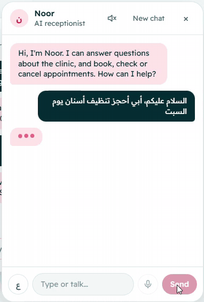
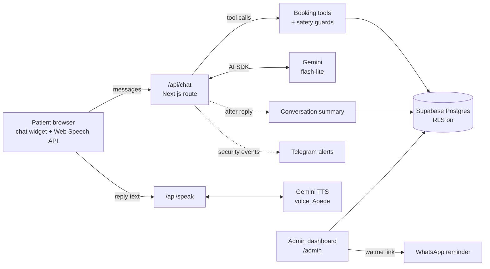

# Noor — AI voice receptionist for a dental clinic

Noor answers patients for **Smile Dental Clinic** (a fictional clinic in Riyadh). She books, checks and cancels appointments by **text or voice**, in **English and Saudi Arabic**, and hands staff a small admin dashboard with reminders, conversation notes and security alerts.

**Live demo:** https://clinic-voice-receptionist.vercel.app — click **Talk to Noor**, then try typing or tapping the mic.



---

## What it does

**For patients**
- Chat or talk to Noor in English or Arabic (polite Saudi dialect, not formal MSA).
- Ask about treatments, prices, dentists and opening hours.
- Book, check and cancel appointments. Noor offers real free times and never double-books.
- Voice mode: tap to start a hands-free conversation, or hold the mic to talk. Noor replies in a natural voice (Gemini TTS) and falls back to the browser's voice if that's unavailable.

**For clinic staff (`/admin`, password protected)**
- **Appointments:** the next 14 days, filterable by dentist, with cancel.
- **Reminders:** the next open day's appointments, each with a one-tap WhatsApp reminder in the patient's language.
- **Conversations:** a short English note of every chat (what the patient wanted, and whether it ended in a booking).
- **Security:** blocked attempts, rate-limit hits and failed logins, with alerts sent to Telegram.

## How it keeps bookings safe

An AI that writes to a real calendar has to be trusted with real data, so the model never gets the final say. Every rule below is enforced in code, not just in the prompt:

| Risk | What stops it |
|---|---|
| Booking without the patient agreeing | Booking is a two-step tool flow: `prepare_booking` reads the details back, and `book_appointment` only unlocks when the patient's very next message replies to that read-back. |
| Details changing between read-back and save | `book_appointment` must match the confirmed service, dentist, date, time and phone exactly. |
| Noor inventing or miscopying a phone number | The number must appear in what the patient actually typed or said. If not, the tool refuses and tells Noor which numbers the patient did give. |
| Two patients in the same slot | A Postgres exclusion constraint (`no_double_booking`) makes overlapping appointments impossible at the database level. |
| Cancelling someone else's appointment | Cancelling needs the appointment ID **and** the phone number it was booked with. |
| Closed days, past times, outside working hours | Checked in code against each dentist's schedule in Riyadh time. |
| Prompt injection / "ignore your instructions" | Detected in English and Arabic and logged; the tools' rules still apply whatever the model is told. |
| Spam and cost abuse | Per-device rate limits on chat and voice, message size limits, admin login lockout (5 tries / 15 min). |

Conversation summaries take the outcome (*booked* / *cancelled*) from the tools' real results, not from the AI's reading of the chat.

## Architecture



- **Frontend:** Next.js 16 (App Router), React 19, Tailwind CSS 4.
- **AI:** Vercel AI SDK v7 with Google Gemini (`gemini-flash-lite-latest` for chat, Gemini TTS for the voice).
- **Speech input:** the browser's Web Speech API, with handling for phones that stop listening after the first pause.
- **Database:** Supabase Postgres. Row Level Security is on with no public policies; only the server talks to it, with the secret key.
- **Hosting:** Vercel (Frankfurt region, close to the database).
- **Quality:** 65 unit tests (Vitest) and GitHub Actions CI running lint, type-check, tests and a production build on every push.

## Project layout

```
app/
  _components/      chat widget and voice hook (useVoice)
  api/chat/         Noor's chat endpoint: limits, tools, summaries
  api/speak/        text-to-speech endpoint
  admin/            staff dashboard: appointments, reminders, conversations, security
lib/
  receptionist.ts   Noor's instructions (tone, Arabic style, booking flow)
  tools.ts          booking tools the AI can call
  booking-guard.ts  confirmation and phone-number checks
  availability.ts   free-slot calculation
  security.ts       rate limits, lockout, injection detection, event log
supabase/           schema, seed data and updates
tests/              unit tests
```

## Running it locally

1. Create a free [Supabase](https://supabase.com) project and run `supabase/schema.sql`, then `supabase/seed.sql`, in its SQL editor.
2. Get a free [Gemini API key](https://aistudio.google.com/apikey).
3. Create `.env.local`:

   ```
   GOOGLE_GENERATIVE_AI_API_KEY=...
   SUPABASE_URL=...
   SUPABASE_SECRET_KEY=...
   ADMIN_PASSWORD=...          # a long, unique password
   SECURITY_SALT=...           # any long random string
   # optional
   TELEGRAM_BOT_TOKEN=...
   TELEGRAM_CHAT_ID=...
   ```

4. Install and run:

   ```
   npm install
   npm run dev
   ```

   Open http://localhost:3000. Run the checks with `npm test`, `npm run lint` and `npm run typecheck`.

## Known limitations

- **Voice input depends on the browser.** It works best in Chrome and Safari. Chrome sends the audio to Google's speech service to turn it into text. Phones sometimes cut a long phone number into pieces; Noor asks again rather than guessing.
- **Free tiers.** Gemini's free tier has daily limits, so the demo can occasionally fall back to the browser voice or ask the patient to try again later.
- **Reminders are one tap, not automatic.** Sending WhatsApp messages automatically needs the WhatsApp Business API, which is outside the scope of a demo.
- **It's a demo clinic.** The dentists, prices and phone number are made up. Please don't enter real personal details.

---

© 2026. All rights reserved. This code is shared for viewing as part of a portfolio; please don't reuse it without permission.
